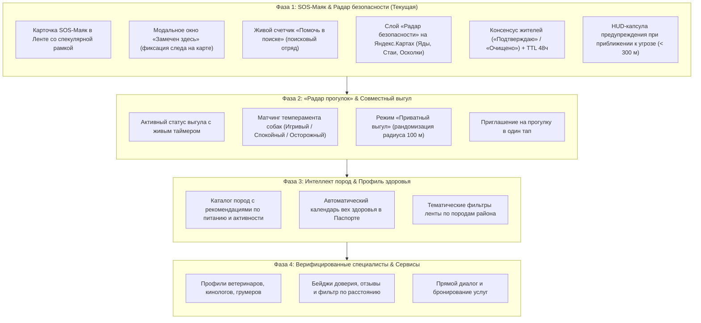

# PawConnect — Спецификация и Анти-Клон Архитектура (Референс Gavs 2.0)

## 1. Концепция: Никакого копирования «в лоб» (Анти-Клон манифест)

Сервис `gavs.app` («Гавс») взят исключительно как **функциональный референс** базовых потребностей собаководов (поиск пропавших, безопасность на улице, совместные прогулки). 

**Принципы уникальности и дифференциации PawConnect**:
1. **Собственный стиль и лексика (Zero-Clone Microcopy)**:
   - Запрещено использовать терминологию Гавса:
     - ❌ «Потеряшки» ➔ ✅ **«SOS-Маяк» / «Экстренный поиск»**
     - ❌ «Видел здесь» ➔ ✅ **«Замечен здесь» / «Отметить след»**
     - ❌ «Иду искать» ➔ ✅ **«Помочь в поиске» / «Поисковый отряд»**
     - ❌ «Опасные участки» ➔ ✅ **«Радар безопасности» / «Зоны риска»**
     - ❌ «Режим невидимки» ➔ ✅ **«Приватный выгул»**
2. **Дизайн-код Apple Liquid Glass 2026**:
   - `gavs.app` — это светлый плоский сайт на Tailwind/Next.js с оранжевыми кнопками и стандартными веб-формами.
   - `PawConnect` — это темная экосистема **Обсидиан (`#0A0A0C`)** со стеклянными карточками, спекулярными градиентными рамками, физикой пружин Cupertino, кастомными шейдерами Яндекс.Карт (Emerald Dark, Cyberpunk, Obsidian) и нативным ощущением премиального приложения уровня iOS / Telegram.
3. **Глубокая синергия с телеметрией питомца**:
   - В `gavs.app` потерянная собака — это изолированное текстовое объявление на доске.
   - В `PawConnect` объявление связано с цифровым паспортом питомца, данными GPS-ошейника, историей безопасных зон и формирует **интерактивный трек перемещений (Breadcrumb Trail)** на карте с таймингом фиксации следов.

---

## 2. Сравнительная матрица: gavs.app vs PawConnect

| Функциональный блок | Референс `gavs.app` | Уникальное решение PawConnect |
|---|---|---|
| **Экстренный поиск питомца** | Белая карточка, плоские кнопки «Видел здесь» и «Иду искать» | **Интерактивный SOS-Маяк**: Глубокая обсидиановая карточка с пульсирующей красной спекулярной рамкой, живой таймер пропажи, кнопка **«Замечен здесь»** с мини-картой фиксации следа и кнопка **«Помочь в поиске»** со счетчиком отряда. |
| **Следы и перемещения** | Обычные текстовые комментарии | **Интерактивный трейл на Яндекс.Картах**: Отмеченные следы («Замечен здесь») отображаются нумерованными янтарными маркерами со временем фиксации («15 мин назад»), визуализируя направление движения собаки. |
| **Предупреждения об угрозах** | Простые статические иконки на карте | **Радар безопасности с консенсусом жителей**: Метки зон риска (☠️ Догхантеры/Яд, 🐕‍🦺 Стаи, ⚠️ Осколки/Арматура), счетчик доверия («Подтверждаю» / «Очищено»), TTL-затухание через 48 часов и всплывающая стеклянная капсула тревоги в верхнем HUD при приближении ближе 300 м. |
| **Совместный выгул** | Список контактов и переключатель невидимки | **Радар совместных прогулок**: Импульсный радар на карте, матчинг по темпераменту из паспорта (Дружелюбный / Игривый / Осторожный), рандомизация координат (100 м) в режиме **«Приватный выгул»**. |
| **Клубы и сообщество** | Форумы по 289 породам | **Интеллект пород в Паспорте**: Автоматические медицинские рекомендации по возрасту и породе, вехи вакцинации и локальные встречи породников в районе. |

---

## 3. 4-Этапный мастер-роадмап

---

## 4. Детализация Фазы 1: SOS-Маяк и Радар безопасности

### 4.1. Карточка «SOS-Маяк» в Ленте
- Располагается в Tab 0 (Лента) в фильтре `SOS` и общем потоке.
- Стилистика: `GlassCard` с темно-обсидиановой подложкой (`#101014`), неоново-красной пульсирующей рамкой (`AppColors.accentRed.withValues(alpha: 0.35)`).
- Метаданные:
  - Бейдж: `🚨 СРОЧНЫЙ ПОИСК`.
  - Время: «Пропал 1.5 ч назад».
  - Дистанция: «650 м от вашей геопозиции».
  - Кличка и порода: «🐾 Арчи · Сибирский хаски · 2 года».
- Интерактивные действия:
  - **«Замечен здесь»**: открывает карточку фиксации следа с мини-картой, где пользователь указывает точку встречи, время («Только что», «15–30 мин назад», «1–2 ч назад») и заметку («Бежал к набережной, без ошейника»).
  - **«Помочь в поиске»**: переключатель участия в поисковом отряде со счетчиком («👥 12 человек в отряде») и haptic feedback.
  - **«Радар поиска»**: мгновенный переход на Яндекс.Карту (Tab 1), отцентрированную на зону пропажи с радиусом поиска.

### 4.2. Трейл перемещений на Яндекс.Картах
- Наблюдения за питомцем связываются в хронологический трек на карте.
- Метки наблюдений — янтарные круги с номерами `①`, `②`, `③` и временем, показывающие траекторию движения собаки.

### 4.3. Радар безопасности (Зоны риска)
- Метки угроз:
  - ☠️ `poison` — Яд / Догхантеры (красный неоновый пульс)
  - 🐕‍🦺 `aggressive_pack` — Агрессивная стая собак (оранжевый)
  - ⚠️ `broken_glass` — Осколки / Арматура (янтарный)
  - 🚧 `hazard_other` — Опасные ямы / люки (серый)
- Народный консенсус:
  - Любой собаковод может нажать `👍 Подтверждаю (+1)` или `🧹 Очищено (+1)`.
  - Если набрано 3 голоса «Очищено», метка снимается с карты.
  - Автозатухание (TTL): метка исчезает через 48 часов, если не было новых подтверждений.
- Proximity Warning:
  - При приближении к подтвержденной угрозе ближе 300 м в верхнем баре `BreachAlertBanner` появляется предупреждение: «⚠️ Внимание: в 230 м замечены догхантеры (подтверждено 4 собаководами)».
